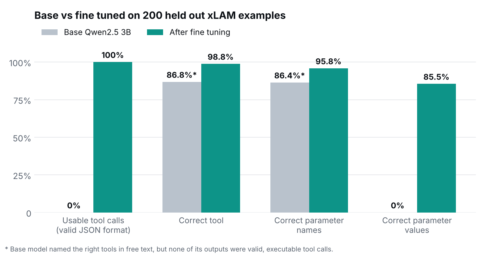
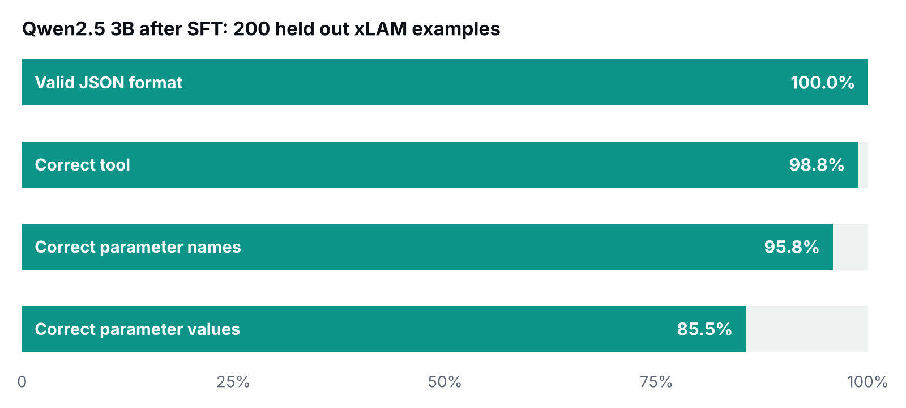
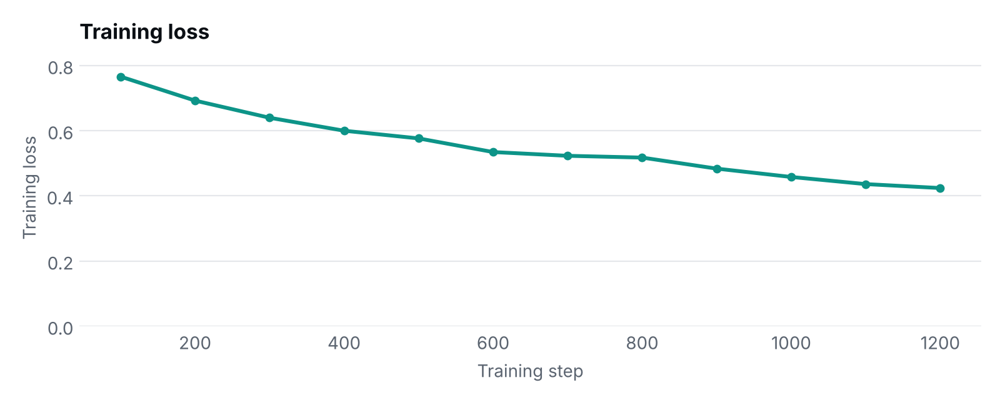

# Function calling SFT · Qwen2.5 3B

Supervised fine tuning that turns a small, 4 bit Qwen2.5 3B model into a reliable **function calling** model: given a user request and a list of tools, it returns the right tool calls as clean JSON.

Trained on a free Colab T4 with LoRA, then evaluated on examples it never saw during training.



## Before and after

Same 200 held out examples, same prompt, same scoring code:

| What is checked | Base Qwen2.5 3B | After fine tuning |
| --- | --- | --- |
| Usable tool calls (valid JSON in the expected format) | **0%** | **100%** |
| Correct tool selected | 86.8%\* | **98.8%** |
| Correct parameter names | 86.4%\* | **95.8%** |
| Correct parameter values | **0%** | **85.5%** |

\* The base model usually *knew* which tool to use, and the scorer gives credit when the tool name appears in free text. But not one of its 200 answers was a call an agent could execute: 156 invented their own `{"endpoint": ..., "params": ...}` shape and 167 were wrapped in Markdown code fences.

Example, "What are the time zones in Europe?":

~~~text
Base model:  ```json {"endpoint": "get_time_zones", "params": {"keyword": "Europe"}} ```
Expected:    [{"name": "get_time_zones", "arguments": {"keyword": "europe"}}]
~~~

**Fine tuning turned a model that understood the request into one that produces exact, executable tool calls.**

How the base model was run: [`eval/eval_base.py`](eval/eval_base.py) rebuilds the notebook's exact test split and prompt, runs `Qwen2.5-3B-Instruct` as an 8 bit GGUF on CPU with llama.cpp and greedy decoding, and scores with [`scoring.py`](scoring.py). Every prediction is saved in [`results/base_model_predictions.jsonl`](results/base_model_predictions.jsonl). The fine tuned model was scored in 4 bit on a T4; this setup, if anything, favours the base model.



## Fine tuned results in detail

200 held out examples from [Salesforce/xlam-function-calling-60k](https://huggingface.co/datasets/Salesforce/xlam-function-calling-60k), checkpoint at step 1000:

| What is checked | Score |
| --- | --- |
| Valid JSON tool call format | **100%** |
| Correct tool selected | **98.8%** |
| Correct parameter names | **95.8%** |
| Correct parameter values | **85.5%** |

Results are stable across checkpoints (full table in [`results/eval_results.csv`](results/eval_results.csv)):

| Checkpoint | Format | Tool | Parameter names | Parameter values |
| --- | --- | --- | --- | --- |
| step 700 | 100% | 98.6% | 94.5% | 83.7% |
| step 800 | 99.5% | 99.0% | 94.8% | 83.6% |
| step 900 | 99.5% | 99.0% | 95.8% | 84.7% |
| step 1000 | 100% | 98.8% | 95.8% | 85.5% |

**Where it still slips:** parameter values. Most misses are close but not exact, for example `"small"` where the API expects `"s"`.

## The task

**Input:** a natural language request plus the available tools.

```text
Query: Please generate a small thumbnail for 'https://example.com/image5' and a large one for 'https://example.com/image6'.

Available Tools:
- get_2_thumbnail_ready: Generate a thumbnail of a specified size from a given URL by polling an API. | Params: size, url
```

**Expected output:** a JSON list of calls, one per action.

```json
[
  {"name": "get_2_thumbnail_ready", "arguments": {"size": "s", "url": "https://example.com/image5"}},
  {"name": "get_2_thumbnail_ready", "arguments": {"size": "l", "url": "https://example.com/image6"}}
]
```

## How it is scored

The scoring functions are in [`scoring.py`](scoring.py). They are deliberately strict:

| Check | How it works |
| --- | --- |
| Format | +0.5 for a valid JSON list of `{name, arguments}` objects, **−0.2** if the output is not valid JSON |
| Tool | Share of expected tools that were called, **minus 0.2 for every tool the model invented** |
| Parameter names | Share of expected argument names used, **minus 0.1 for every invented argument** |
| Parameter values | Share of expected argument values that match exactly (case insensitive) |

Penalising hallucinated tools and arguments matters: in an agent, calling a tool that does not exist is worse than calling none.

## Setup

| | |
| --- | --- |
| Base model | `unsloth/Qwen2.5-3B-Instruct-bnb-4bit` |
| Method | LoRA SFT (rank 16, all attention and MLP projections, ~1% of weights trained) with Unsloth and TRL |
| Data | 10,000 training and 500 held out examples from xLAM 60k, prompts over 1,024 tokens filtered out |
| Training | 1 epoch (1,250 steps), batch size 8, lr 2e-4, chat template prompts |
| Hardware | 1 × Tesla T4 (free Colab) |

Training loss fell from 0.77 to 0.42:



Checkpoints are on Hugging Face: [faraya1/Qwen2.5-3B-RAG-API-Finetuned-Models](https://huggingface.co/faraya1/Qwen2.5-3B-RAG-API-Finetuned-Models).

## Run it

1. Open [`function_calling_sft_qwen3b.ipynb`](function_calling_sft_qwen3b.ipynb) in Colab with a GPU runtime.
2. Log in to Hugging Face when prompted. The notebook downloads xLAM, builds the train and test splits, trains, and pushes checkpoints to your account.
3. Run the evaluation cells to score checkpoints on the held out split.

The xLAM dataset is gated on Hugging Face, so accept its terms on the dataset page first.

## Next steps

- Evaluate on the full 500 example test split and on a different function calling benchmark.
- Reduce parameter value errors with value normalisation hints in the tool descriptions.

## Repository

```text
function_calling_sft_qwen3b.ipynb   training and evaluation notebook (Colab)
scoring.py                          the four scoring functions
eval/eval_base.py                   base model evaluation (CPU, llama.cpp)
results/base_model_predictions.jsonl  every base model answer with its gold call
results/eval_results.csv            scores per checkpoint
results/training_loss.csv           loss per 100 steps
results/*.png                       charts above
```

---

Built by [Faraya Baig](https://github.com/Farayabaig), AI Engineer working on agents, RAG and AI security.
